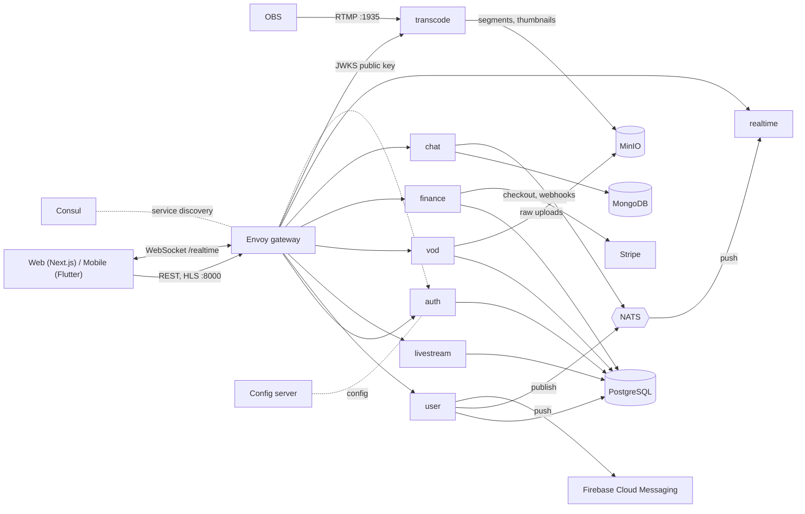

# LETS LIVE

## ABOUT

This is a project about livestreaming technologies and the solutions around them.
The goal is a working livestreaming platform built from A to Z, like Twitch: go live from OBS, watch with low latency, chat, upload videos, message friends, and send gifts.

There is a web app (Next.js) and a mobile app (Flutter), both talking to a set of Go microservices.

Demo page (mock data): https://letslive.vercel.app

## FEATURES

- **Livestreaming:** stream from OBS over RTMP and watch in the browser or app with low-latency HLS (LL-HLS), about 4s behind the streamer. Qualities are picked from what the streamer sends, never upscaled.
- **VODs:** every livestream is recorded as a VOD. Creators can also upload videos (up to 100MB), which go through the same video engine. VODs have likes, comments with replies, and view counts.
- **Live chat:** emotes, slash commands, and custom chat commands for each channel.
- **Direct messages:** one-to-one and group chats with pictures, typing indicators, read state, and online presence.
- **Notifications:** in-app and live over WebSocket, plus mobile push through Firebase Cloud Messaging.
- **Search:** one search box for channels, live streams, and videos. It tolerates typos and ignores Vietnamese accents.
- **Wallet, shop and gifts:** deposits with Stripe, a shop with an inventory, and gifts sent to streamers.
- **Accounts:** email + OTP sign-up, Google sign-in, Cloudflare Turnstile (web) and Firebase App Check (mobile) for bot protection, and English / Vietnamese.

## HOW IT WORKS

- **Live video:** OBS pushes RTMP to the transcode service. For each stream, a Go session copies the source quality as-is and uses FFmpeg only to encode the lower qualities. Each quality is packaged as LL-HLS in memory (with [gohlslib](https://github.com/bluenviron/gohlslib)) and served through the gateway. At the same time, a recorder uploads VOD segments to MinIO, and a thumbnailer saves a frame every minute.
- **Uploads:** the VOD service stores the raw file in MinIO and queues a transcode job. A transcode worker picks the job up and runs the same live engine in "file mode", so an upload comes out the same way as a recorded stream.
- **Requests:** every client request goes through the Envoy gateway. Envoy checks the access token (ES256 JWT, public key from the auth service's JWKS endpoint), applies rate limits and CORS, and routes to the service found through Consul.
- **Realtime:** all WebSockets are held by one `realtime` service. Clients only receive on the socket. Every write goes through REST to the service that owns the data, which saves it and then publishes the event on NATS. The realtime service forwards it to the subscribed sockets.

## ARCHITECTURE



Services call each other over HTTP, found through Consul. Each service reads its settings from the config server, which serves them from a Git repository.

### Services

| Service | Port | Language / store | What it does |
| --- | --- | --- | --- |
| `auth` | 7777 | Go, PostgreSQL | Sign-up, login, Google sign-in, OTP email, tokens, JWKS |
| `user` | 7778 | Go, PostgreSQL | Profiles, follows, notifications, gifts and inventory, device tokens and push |
| `transcode` | 1935, 7779, 8889 | Go, FFmpeg | RTMP ingest, LL-HLS packaging, VOD recording, upload transcode worker |
| `chat` | 7780 | Go, MongoDB | Live chat, chat commands, direct messages |
| `livestream` | 7781 | Go, PostgreSQL | Livestream sessions and their state |
| `vod` | 7782 | Go, PostgreSQL | VODs, uploads, comments, reactions, transcode jobs |
| `finance` | 7783 | Go, PostgreSQL | Wallets, double-entry ledger, Stripe deposits, shop |
| `realtime` | 7785 | Go | WebSocket gateway, presence |
| `configserver` | 8181 | Java (Spring Cloud Config) | Serves each service's config from a Git repository |

## TECHNOLOGIES AND TOOLS

- **Backend:** Go 1.26, PostgreSQL 17, MongoDB 7, NATS, FFmpeg, gohlslib, Stripe, Firebase (Cloud Messaging and App Check).
- **Infrastructure:** Envoy (API gateway), Consul (service discovery), Spring Cloud Config Server, MinIO (object storage), Docker and Docker Compose.
- **Web:** Next.js 16, React 19, TanStack Query, Tailwind CSS 4, react-player, i18next, MSW (mock mode), Sentry.
- **Mobile:** Flutter, Riverpod, go_router, dio, better_player_plus.
- **Observability:** OpenTelemetry, Grafana, Loki + Promtail (logs), Tempo (traces).
- **CI/CD:** GitHub Actions (tests, image builds, deploy, mobile builds and release, web/mobile parity check).

## REPOSITORY LAYOUT

```
backend/    Go services (one module each, joined by go.work) and the config server
  shared/   Code shared by the Go services: discovery, JWT, logger, NATS, realtime, tracing
web/        Next.js web app
mobile/     Flutter app
configs/    Envoy, nginx, Grafana stack and Consul configs
docs/       Design docs, open issues, web/mobile parity table
```

## PORTS

- 8000: Envoy gateway, the main entry point for the API, WebSockets (`/realtime`) and live video (`/transcode`).
- 1935: RTMP ingest (point OBS at `rtmp://<host>:1935`).
- 8889: transcode web server (HLS playlists and segments; reached through the gateway at `/transcode`).
- 5000: web client (Docker image).
- 12345: Grafana (logs and traces).
- 11111: Swagger UI with every service's OpenAPI spec.
- 8500: Consul UI.
- 9000 / 9090: MinIO API / console.
- 4222: NATS.
- 9999: PostgreSQL. 9993: MongoDB.

## INSTALLATION (LOCAL)

1. Clone the repo.
2. Copy `example.env` to `.env` and fill it in. Each variable is explained in the file. Leaving `FIREBASE_PROJECT_ID` and `FIREBASE_SERVICE_ACCOUNT_JSON` empty turns App Check and mobile push off.
3. Generate the access token signing key and put it in `ACCESS_TOKEN_PRIVATE_KEY`:
   ```bash
   openssl ecparam -name prime256v1 -genkey -noout | openssl pkcs8 -topk8 -nocrypt | base64 | tr -d '\n'
   ```
4. Point `CONFIG_SERVER_GIT_URI` (and its username and password) at the Git repository that holds the services' config files. The services read their settings from it through the config server at startup, and that repository is not part of this one.
5. Start everything:
   - From the published images: `docker compose up`, then open the web client at http://localhost:5000.
   - Or build the backend from source: `docker compose -f docker-compose-dev.yaml up --build`. This file has no web service, so run the web app separately (below).

The PostgreSQL databases for each service are created on the first start by `docker-entrypoint-initdb.d/01-create-dbs.sql`.

### Web client

From [`web`](./web): `npm install`, then `npm run dev` against a running backend.

To work on the UI without Docker or the Go services, run `npm run dev:mock`. That loads `.env.mock` and serves the app with [MSW](https://mswjs.io/) handling backend calls in the browser. More detail is in [`web/README.md`](./web/README.md).

### Mobile app

From [`mobile`](./mobile): `flutter run --flavor dev --dart-define-from-file=env/dev.json`. Setup (backend address, Firebase, Google sign-in) is in [`mobile/README.md`](./mobile/README.md).

The mobile app must stay in step with the web app. A change to web pages, web API clients or gateway routes needs the mobile equivalent or an entry in [`docs/PARITY.md`](./docs/PARITY.md), and CI checks it. The rules are in [`AGENTS.md`](./AGENTS.md).

### Tests

- Go: `go test ./...` inside a service folder, for example `backend/vod`.
- Web: `npm run lint` and `npm run build` in `web`.
- Mobile: `flutter analyze`, `flutter test` and `dart run tool/parity_check.dart` in `mobile`.

## DEPLOYMENT

Before you deploy (including the GitHub Actions **deploy** workflow on a self-hosted runner):

1. **Access token key:** access tokens are signed with ES256. Generate a key once (the command in step 3 above) and store it as the `ACCESS_TOKEN_PRIVATE_KEY` GitHub secret / env var of the auth service. Nothing else needs the key: the gateway and the other services fetch the public half from auth's JWKS endpoint (`JWKS_URL`, default `http://auth:7777/v1/.well-known/jwks.json`). Logins signed with a previous key stop working, so users sign in again.
2. **CORS origins:** in [`configs/envoy/envoy.yaml`](./configs/envoy/envoy.yaml), the `envoy.filters.http.cors` policy under the virtual host echoes any origin with credentials. For production, replace the `.*` regex in `allow_origin_string_match` with your real browser origins (for example your production and staging site URLs).
3. **Host nginx:** public traffic goes through nginx to the Envoy gateway. [`configs/nginx.conf`](./configs/nginx.conf) and [`configs/nginx-http.conf`](./configs/nginx-http.conf) include a cache for live video, so viewer requests don't all reach the transcode service. CI does not deploy them, so apply them on the host by hand.

The gateway config is validated with `docker run --rm -v "$PWD/configs/envoy/envoy.yaml:/etc/envoy/envoy.yaml:ro" envoyproxy/envoy:v1.36-latest --mode validate -c /etc/envoy/envoy.yaml`. Envoy's admin interface listens on `127.0.0.1:9901` inside its container only; use `docker exec letslive-envoy` to reach it.

## DOCS

- [`docs/ISSUES.md`](./docs/ISSUES.md): known issues and open security findings.
- [`docs/PARITY.md`](./docs/PARITY.md) and [`docs/MOBILE_ISSUES.md`](./docs/MOBILE_ISSUES.md): web/mobile parity and known mobile gaps.
- [`docs/SEARCH.md`](./docs/SEARCH.md), [`docs/CHAT_COMMANDS.md`](./docs/CHAT_COMMANDS.md), [`docs/VOD_UPLOAD_FLOW.md`](./docs/VOD_UPLOAD_FLOW.md): how those features work.
- [`docs/superpowers/specs`](./docs/superpowers/specs): design docs for the larger features (realtime gateway, LL-HLS pipeline, upload file mode, mobile app, shop and gifts).
- [`docs/STORIES.md`](./docs/STORIES.md), [`docs/CHANNEL_BADGES_AND_POINTS.md`](./docs/CHANNEL_BADGES_AND_POINTS.md): planned features, not built yet.

Last edited: 20/11/2026  
**[Editor: Nam Huynh](https://github.com/ThNam203)**
